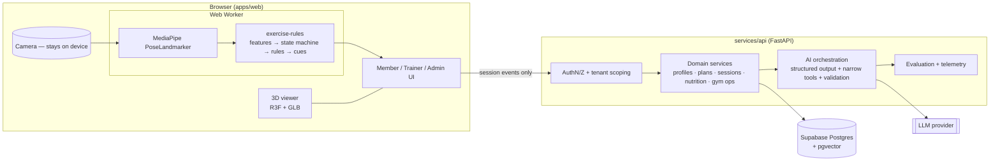

# Architecture overview

## Boundaries that must not erode

1. Nothing below the worker line leaves the device except `SessionEvent`s.
2. The API is the authority for permissions, plans, history. The browser never writes to the DB directly.
3. The LLM only sees authorized context and can only act through validated tools.
4. Contracts in `packages/exercise-contracts` are the single shape for exercises and events.

## Module map → blueprint

| Blueprint                      | Code                                                                  |
| ------------------------------ | --------------------------------------------------------------------- |
| §8 Stage 1 landmark extraction | `apps/web/src/features/live-coaching/worker`                          |
| §8 Stages 2–5                  | `packages/exercise-rules`                                             |
| §9 AI orchestration            | `services/api/app/services/{plans,coaching,nutrition,llm}`            |
| §10 AI evaluation              | `services/api/app/services/evaluation`, `data/evaluation-fixtures/ai` |
| §6 data model                  | `services/api/app/models` + Alembic migrations                        |
